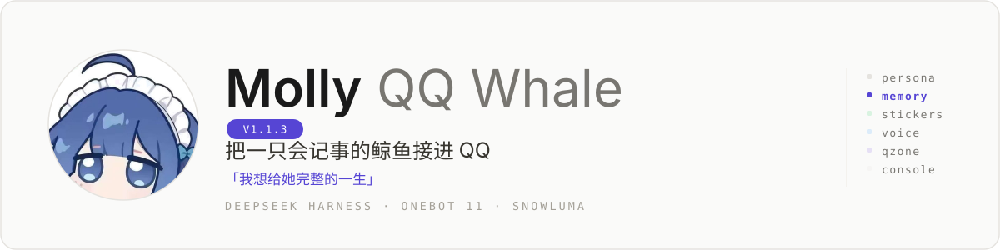
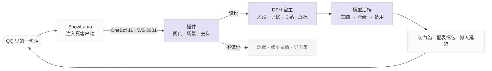

<div align="center">



基于 **DeepSeek Harness** 的 QQ 通道插件：稳定的人设、长期记忆、表情包习惯、会发语音，
以及一个能看懂她此刻在干什么的控制台。

**v1.1.5-preview.1**（预览）—— 控制台补数据、QQ 页合并：①学习器、记忆、群数不再显示「—」——插件 `/state` 本来就有记忆条数、学习器累计/今日、SnowLuma 群列表（10 个群）等数据，是控制台没接上；现在由 `tools/console-server.mjs` 统一补齐（群数走 OneBot `get_group_list`；记忆在 QQ 记忆池加密后走插件兜底，并标注来源「插件」）。②QQ 下「登录」「QQ 连接」两个模块合并为一页「QQ 连接」：连接状态卡 + 扫码登录同页，没连上时顶部黄条直接指过去；旧地址 `#/login` 自动跳到 `#/qq`。

上一版 **v1.1.3-Hotfix.2**（热修复）—— 给「她读不懂别人发的语音」再加一层本地兜底：群聊里别人发的语音，QQ 自带转写拿不到结果时（之前实测会 20 秒超时、回「[语音：没听清]」），改用本机 faster-whisper 识别（复用 `${MOLLY_ROOT}\data\video\venv` 里已装的模型，不联网、无新依赖，首次加载约 1.6 秒、之后每段 1.4–1.6 秒），失败才降级「[语音：没听清]」；控制台**左下角版本号改可点击**，点开就是「本次更新」，内容直接读仓库 `docs/CHANGELOG.md` 最新一节，不再另外维护文案。

上一版 **v1.1.3-Hotfix.1**（热修复）—— 修「她读不懂别人发的语音」：别人发语音时，用 QQ 自带的语音转文字（SnowLuma 扩展 `fetch_ptt_text`，实测 0.2–0.3 秒）先转成文字再交给模型（以前她只看得见「[语音]」三个字，只能回「听不出说的啥，换成字」）；转写失败降级成「[语音：没听清]」，不会当成空消息丢掉；带 10 分钟缓存，同一条语音只转一次；不想花这次接口往返可以 `voiceTranscribeEnabled: false` 关掉。

上一版 **v1.1.3**（正式版）—— 三个预览版合并发布：戳一戳改用模型回一句；控制台清掉 NapCat 品牌、改四态 QQ 状态判定，**左下角版本号改为从插件版本自动读取**（以前写死显示 1.0）；记忆池新增「梗」类；上下文体积优化 A（一轮完整提示词 6,869 → 5,935 token，省 13.6%）；修「@ 错人」——她不再靠猜着 @ 人，模型写的 @ 号必须先过校验（只认最近 20 条里真说过话的人），拥挤/被空 @/点名时按条件带「引用」，引用发不出去自动退回纯文字；QQ 不支持「引用 + 语音」，引用时语音段会自动降级成文字。**控制台表情包页新增搜索**：按名字 / 关键词即时过滤（空格分隔多个词 = 同时匹配，`_` 当空格，「白猫 偷笑」能直接找到「白猫_眯眼_偷笑_坏笑」），副标题显示「命中 M / 共 N 张」，没搜到时空态里一键清空。更早 **v1.1.3-preview.3** 只含 @ 修复；**v1.1.3-preview.1** 是戳一戳模型回话 + 控制台改版。

[](LICENSE) [](https://nodejs.org) [](#环境要求) [](#环境要求) [](#环境要求)

</div>

> [!IMPORTANT]
> 这是**一套框架，不是一个角色**。仓库里没有她的人设、记忆或聊天记录 ——
> `persona/core.example.md`、`memory.example.json` 都只是结构示例。
> 你要写的那个「她」，不在仓库里。

<details>
<summary><b>目录</b></summary>

- [它是什么](#它是什么)
- [一条消息的一生](#一条消息的一生)
- [三个闭环](#三个闭环)
- [环境要求](#环境要求)
- [十分钟跑起来](#十分钟跑起来)
- [控制台](#控制台)
- [设计语言](#设计语言)
- [目录结构](#目录结构)
- [文档](#文档)
- [安全边界](#安全边界重要)
- [常见问题](#常见问题)
- [参与开发](#参与开发)
- [许可与致谢](#许可与致谢)

</details>

## 它是什么

一句话：**QQ 只是一根线，线那头是真的在跑的她。**

| 她有的 | 怎么来的 | 你看到的效果 |
|:--|:--|:--|
| **人设** | 人格写在 `persona/*.md` 里：怎么说话、底线在哪、对不同的人用什么语气 | 改文件 + 重载插件就换一个人；不是换个提示词那种换 |
| **记忆** | 短期窗口之外还有长期库和关系画像；模型按批抽事实，没把握的先进「待核实区」；默认 2000 条、记满自动长到 1 万，写入先去重（新的覆盖旧的），落盘加密 | 她记得你上周说过要搬家，也记得你讨厌被叫全名 |
| **表情包** | 收到的图会自动学（有日配额和体积上限），按语境挑，一条回复最多两张 | 聊着聊着甩一张图过来，不是随机贴表情 |
| **语音** | 接 SnowLuma 的 PTT 通道，edge-tts 打底，也能挂 GPT-SoVITS 社区音色；她说 `<voice>` 才发，23:50–9:00 静默 | 想听就直说「发个语音」，不用等运气 |
| **戳一戳** | 收到戳一戳会回应：默认窗口内戳多了会生气，也可能反戳你 | 手欠一下，她会回你一句 |
| **手（V1.0）** | 合并转发的正文进上下文；QQ 空间能读、能写草稿，发布必须你确认；群里叫她的名字会应 | 她会看、会等批准，不擅自替你发 |
| **先查再说** | 事实性问题先委派干活会话去查，再用自己的话讲；查不到就说不知道 | 不编。宁可漏，不可滥 |
| **干活** | 以 `命令` 开头的指令会进常驻 agent：读文件、跑脚本、整理资料，进度实时播报到 QQ | 她一边干一边碎碎念，不是等十分钟后甩一个结果 |
| **控制台** | 15 个页面的本地控制台 | 她在跟谁聊、记得什么、花了多少积分、守护进程是不是还活着 |
| **看门狗** | 计划任务定时巡检，掉线自动重连、重登、重启；撞上风控就闭嘴等 | 你睡觉的时候她也在，出事了先自己爬起来 |

她刻意不做三件事：**不替你决定人设**、**不越权改你的代码**、**不上传任何数据**。

## 一条消息的一生

群里有人说话，到她回一句话，中间大概是这样：



绕这么多，是因为三件事必须同时成立：

1. **像个人** —— 回复前有「正在输入」的真实节奏，长回复切成多个气泡，气泡之间有间隔，情绪到了会补一张表情包；
2. **说得对** —— 上下文里塞的是她的人设、长期记忆、关系画像和这个群最近的氛围，而不是干巴巴的聊天历史；
3. **不出事** —— 权限、沙箱、预算、降级链、超时，每一层都在她犯错之前拦住她。

细节在代码里：`lib/onebot.js` 收发 → `lib/gatekeeper.js` 过闸门 → `lib/engine.js` 决定说什么 → `lib/commands.js` 处理指令。

## 三个闭环

- **记忆** —— 规则层先抓「我叫 / 我喜欢 / 我住在 / 我养了…」，模型层再按批抽；进库前过质量闸门，没把握的先进「待核实」。
  边界：不全存；上限默认 2000 条（记满自动扩到 1 万）；写入先去重，同一件事不重复存；落盘 AES-256-GCM 加密，密钥默认 `keys/memory.key`、可与数据分开放；`tools/backup-memory.ps1` 定时备份到两块盘。
- **表情** —— 群里别人发的图自动入库（体积 + 每日配额双重限制），轮到她就按语境挑一张。
  边界：学来的图有上限；觉得不像她会用的，控制台里删掉。
- **自愈** —— 掉线 30 秒重连；群名片被改成「（在想…）」会自己撕回去；积分额度状态落盘，重启不丢。
  边界：只修复自己造成的状态，不碰别人的名片。

## 环境要求

| 你需要 | 说明 |
|:--|:--|
| **Windows 10 / 11** | 主目标平台。插件与控制台是纯 Node，但运维脚本（守护、计划任务、快捷方式）是 Windows 的 |
| **Node.js ≥ 22** | DSH 自带运行时也行；仓库里的 43 个自测脚本用它跑 |
| **DeepSeek Harness** | 宿主。插件以 `dsh.bundle` 的形式挂进 profile |
| **一个 QQ 号** | 建议小号。Molly 会用这个号登录、说话、发图 |
| **SnowLuma** | 把真 QQ 客户端接成 OneBot 11 通道（HTTP 3000 / WS 3001）。许可为源码可见、非商业，商用前先确认。本仓库**不含** SnowLuma，去上游下 |
| **一个模型接口** | 任意 OpenAI 兼容接口即可，也可以接 WorkBuddy 的免费额度（见第 3 步） |

## 十分钟跑起来

下面四步能让她在你自己的 QQ 里说话。卡住了先看对应的那篇文档。

先把仓库放到本机（`git clone` 或下载 zip），下文假设它在 `D:\molly-qq-whale`。

### 1 · 把 QQ 接成通道

装好 **SnowLuma**（OneBot 11 框架，要求 Node ≥ 22、与 QQ 同用户同权限），解压后编辑它目录里的 `config\onebot.json`，在 `networks` 里开一对本机 HTTP + WebSocket：

```json
{
  "networks": {
    "httpServers": [{
      "name": "http-local", "enabled": true, "host": "127.0.0.1", "port": 3000,
      "accessToken": "自己定一个", "messageFormat": "array", "reportSelfMessage": true
    }],
    "wsServers": [{
      "name": "dsh-qq-whale", "enabled": true, "host": "127.0.0.1", "port": 3001,
      "role": "Universal", "accessToken": "自己定一个", "messageFormat": "array", "reportSelfMessage": true
    }]
  }
}
```

然后跑 `launcher.bat`，扫码登录你的小号——SnowLuma 的 WebUI 在 `http://127.0.0.1:5099`。HTTP 3000 给看门狗探活、WS 3001 给插件收发；两处 Token 要一致，等会儿填进 `onebotToken`。

SnowLuma 的版本、Hook 与 QQ 客户端的匹配关系与 DSH 无关，按它自己的说明走。

### 2 · 把插件挂进 DSH profile

```powershell
# 假设仓库在 D:\molly-qq-whale，profile 名为 desktop（DSH 桌面版默认叫这个）
$pdir = "$env:USERPROFILE\.dsh\profiles\desktop\node_modules"
Copy-Item .\plugin\dsh-qq-whale $pdir -Recurse -Force
Copy-Item .\plugin\dsh-qq-pest  $pdir -Recurse -Force   # 可选：嘴臭模式，装法同主插件
```

然后改 profile 里的两个文件：

1. **`package.json`** —— `dependencies` 里加一行 `"dsh-qq-whale": "file:D:/molly-qq-whale/plugin/dsh-qq-whale"`，`dsh.profile.bundles` 数组末尾加 `"dsh-qq-whale"`；
2. **`cordis.patch.yml`** —— 把 [config/cordis.patch.example.yml](config/cordis.patch.example.yml) 改好（QQ 号、群号、Token、目录、模型），追加到文件末尾。

重启 DSH 宿主。插件只在宿主启动时合并补丁，**热重载只对 `lib/*.js` 的改动生效**。

> 排错：插件加载失败是静默的。检查 `package.json` 里那个 `file:` 路径是否真的存在，以及 profile 的 `node_modules\dsh-qq-whale\` 里是不是有 `lib/boot.js`。完整步骤与三档回滚见 [docs/INSTALL-AND-ROLLBACK.md](docs/INSTALL-AND-ROLLBACK.md)。

### 3 · 接上模型

两种接法，选一种：

**A. 用你自己的 OpenAI 兼容接口（推荐）**

先在宿主里注册这个 provider（`baseURL` 只写到 `/v1`），再让 Molly 指向它：

```yaml
config:
  modelBackend: dsh          # wbai（直连）| wb-proxy（本地多账号池）| dsh（走宿主）
  provider: my-openai        # 宿主 providers 里的 key，不是模型名
  model: my-model-id
```

**B. 用 WorkBuddy 的免费额度**

`modelBackend: wbai` 直连桌面端凭据；`modelBackend: wb-proxy` 走本地多账号池网关。

两条链路（聊天 / 干活）的区别、模型降级顺序、常见 404 与 403 的坑，见 [docs/llm-adapter.md](docs/llm-adapter.md)。

### 4 · 写她

```powershell
Copy-Item .\persona\core.example.md .\persona\core.md
# 然后把 cordis.patch.yml 里的 personaDir 指向这个目录：
# D:/molly-qq-whale/persona
```

改完重载插件就生效。示例文件里写的是**结构**，不是人 —— 照抄只会得到一个不像任何人的机器人。写法见 [docs/persona-guide.md](docs/persona-guide.md)。

## 控制台

控制台是给人看的，不是给她用的：读的数据来自本机，**写操作全部走插件**，前端不直接碰文件。

```powershell
# 源码模式：先写 tools\console.json，再启服务
node tools\console-server.mjs      # 或直接双击 .\console.cmd
```

然后打开 `http://127.0.0.1:19392`。`tools\console.json` 至少要有这几项（默认值指向作者本机的目录，换成你的）：

```json
{
  "root": "D:\\molly-qq-whale",
  "dataDir": "D:\\molly-data\\qq-whale",
  "nodeExe": "C:\\Program Files\\nodejs\\node.exe"
}
```

- **15 个页面**：总览 · 会话与消息 · 记忆 · 待核实 · 表情包 · 发言开关 · 预算 · 干活 · 守护 · 运维 · 外部服务 · 通道（SnowLuma）· 登录 · 执行块 · 设置
- 只监听 `127.0.0.1`；宿主端口每次重启都会换，服务端自己探。
- 打包成单文件 exe 见 [docs/deploy.md](docs/deploy.md)。

## 设计语言

控制台不是随手拼的界面。视觉规范写在 [docs/console-design.md](docs/console-design.md)，来源是 [VoltAgent/awesome-design-md](https://github.com/VoltAgent/awesome-design-md) 里的 **Notion DESIGN.md**。

整套只做浅色，像一张白纸：安静、可读、不发光。

- **一个强调色** —— 只有主操作是紫色，其余全是黑灰文字；
- **1px 发丝线代替阴影** —— 卡片默认没有阴影，靠边框分层；
- **粉彩只做背景** —— 记忆是薰衣草、表情是薄荷、预算天蓝、守护奶油，颜色只承担归类；
- **数字等宽** —— 所有指标用等宽字体 + `tabular-nums`，扫一眼就能比大小。

| 用途 | 值 |
|:--|:--|
| 画布 / 卡片 | `#ffffff` / `#fafaf9` |
| 分隔线 | `#e5e3df`，更浅一档 `#ede9e4` |
| 文字四级 | `#1a1a1a` · `#37352f` · `#5d5b54` · `#787671` |
| 唯一强调 | 紫 `#5645d4`，按下时 `#4534b3` |
| 状态 | 成功 `#1aae39` · 警告 `#dd5b00` · 错误 `#e03131` |
| 圆角 | 6 / 8 / 12 / 9999 px |
| 间距 | 4px 基数：4 · 8 · 12 · 16 · 20 · 24 · 32 · 40 |
| 字号 | 22 标题 · 15 卡片标题 · 13 正文 · 11 微标签 |

不做：深色模式、发光、玻璃拟态、外部字体与 CDN。

## 目录结构

```
molly-qq-whale/
├─ plugin/
│  ├─ dsh-qq-whale/        主插件：37 个模块，QQ 收发的全部逻辑
│  └─ dsh-qq-pest/         可选的「嘴臭模式」，独立状态机，可单独卸载
├─ console/                控制台前端（零依赖静态页）
├─ tools/                  控制台服务端 + 守护 + 打包 + 43 个自测脚本
├─ persona/                core.example.md：人设模板（不含真实人设）
├─ config/                 cordis.patch.example.yml 等挂载与配置样例
├─ docs/                   16 篇文档：安装、契约、设计、部署、记忆、人设…
├─ assets/                 README 插图
├─ memory.example.json     记忆库结构示例
└─ console.cmd             双击开控制台（Windows）
```

## 文档

**上手**

| 文档 | 讲什么 |
|:--|:--|
| [INSTALL-AND-ROLLBACK.md](docs/INSTALL-AND-ROLLBACK.md) | 从零装起来，以及三档回滚（关插件 / 还原 profile / 整目录退回） |
| [llm-adapter.md](docs/llm-adapter.md) | 接自己的 OpenAI 兼容 API，两条链路的区别 |
| [persona-guide.md](docs/persona-guide.md) | 人设怎么写，为什么要拆成几个文件 |
| [memory-guide.md](docs/memory-guide.md) | 记忆怎么长出来、怎么审、怎么删 |
| [adm-usage.md](docs/adm-usage.md) | 管理员能做什么，不能做什么 |

**内部契约**

| 文档 | 讲什么 |
|:--|:--|
| [console-contract.md](docs/console-contract.md) | 控制台接口契约 v1，唯一事实来源 |
| [console-crud-contract.md](docs/console-crud-contract.md) | 记忆与表情包的 CRUD 契约 |
| [console-design.md](docs/console-design.md) | 视觉规范：token、组件、Do / Don't |
| [patch-quote-engine.md](docs/patch-quote-engine.md) | 「被引用消息的正文」怎么接进 engine |

**部署与运维**

| 文档 | 讲什么 |
|:--|:--|
| [deploy.md](docs/deploy.md) | 控制台打包成单文件 exe 并部署 |
| [server-deploy-plan.md](docs/server-deploy-plan.md) | 放到服务器上：域名、443、反代 |
| [gateway-workbuddy.md](docs/gateway-workbuddy.md) | 网关接入协议（可选链路） |
| [blackwindow-fix.md](docs/blackwindow-fix.md) | 后台黑窗口闪烁的根因与修法 |
| [g-migration-contract.md](docs/g-migration-contract.md) | 搬迁预演契约（生产环境一个字都不能动） |
| [github-upload.md](docs/github-upload.md) | 从零上传 GitHub，以及哪些文件绝对不能进仓库 |

**变更**

| 文档 | 讲什么 |
|:--|:--|
| [CHANGELOG.md](docs/CHANGELOG.md) | 症状 → 根因 → 修法 → 怎么退回 |

## 安全边界（重要）

> [!WARNING]
> Molly 是真的能动手的：她能读文件、跑脚本、发消息。下面几条不是建议，是默认行为，**别在不理解的情况下关掉**。

- **只听本机** —— 控制台、插件接口、通道后端全部绑定 `127.0.0.1`，不对外开端口；
- **三级角色** —— `owner` > `adm`（指令、工坊）> `guest`（只能聊天），谁是谁写在配置里，运行期不可改；
- **命令要批准** —— 改代码会写成 `pending-code.json` 等你回「1」；群名片被改会自己撕回原样；同一时间只跑一个，其余排队；
- **受保护路径 DENY** —— 人设、记忆、凭据目录默认不允许命令会话碰；
- **沙箱 cwd** —— 干活会话固定在 `workSandboxDir` 里，不落在你的项目目录；
- **硬超时** —— 单轮 180 秒，没有 `ask_user_question`：她不会弹窗等你，超时就放弃，然后说一句人话；
- **不上传** —— 唯一的出站流量是模型接口本身。

## 常见问题

<details>
<summary><b>能换成我自己的模型吗？</b></summary>

能。聊天和干活是两条独立的链路，可以把聊天接到你的 OpenAI 兼容接口，同时让干活继续用别的模型。见 [llm-adapter.md](docs/llm-adapter.md)。
</details>

<details>
<summary><b>她会不会乱说话、乱执行？</b></summary>

默认不会执行：命令要人批、路径有白名单、目录有沙箱、单轮有超时。但请把它当成**一个能动手的实习生**，而不是一个沙盒里的玩具。
</details>

<details>
<summary><b>支持 Linux / macOS 吗？</b></summary>

插件和控制台是纯 Node，能跑；但守护、计划任务、快捷方式这些运维脚本是 Windows 专用。别指望在服务器上一键部署。
</details>

<details>
<summary><b>为什么 README 里没有她的照片？</b></summary>

因为人设不在仓库里。这是有意的：你的鲸鱼应该是你的。
</details>

<details>
<summary><b>她占多少资源？</b></summary>

一个 Node 进程（插件跑在 DSH 宿主里）+ 一个控制台进程 + SnowLuma 拉起的 QQ。没有数据库，没有容器。
</details>

## 参与开发

这是个能跑的东西，不是框架设计稿。它长得像「一个人的项目长起来的样子」：有重复、有历史包袱、部分模块还在重写。但它跑在生产环境里 —— 真 QQ、真群、真限流，[CHANGELOG](docs/CHANGELOG.md) 里每一条修复背后都是一次线上事故。

- 改之前先看 [CONTRIBUTING.md](CONTRIBUTING.md)；
- 自测是纯 Node 脚本，没有测试框架：`node tools\test-memory.mjs`；
- 提交前跑一次 `node tools\scan-secrets.mjs`，别把凭据带进来。

## 许可与致谢

MIT，见 [LICENSE](LICENSE)。

致谢：DeepSeek Harness（宿主）·
SnowLuma（QQ 通道后端，OneBot 11 实现；源码可见、非商业许可）·
[VoltAgent/awesome-design-md](https://github.com/VoltAgent/awesome-design-md)（控制台视觉语言）。

<div align="center">
<sub>她记得你说过的话 —— 至于怎么记得的，看 <a href="docs/memory-guide.md">memory-guide.md</a>。</sub>
</div>
