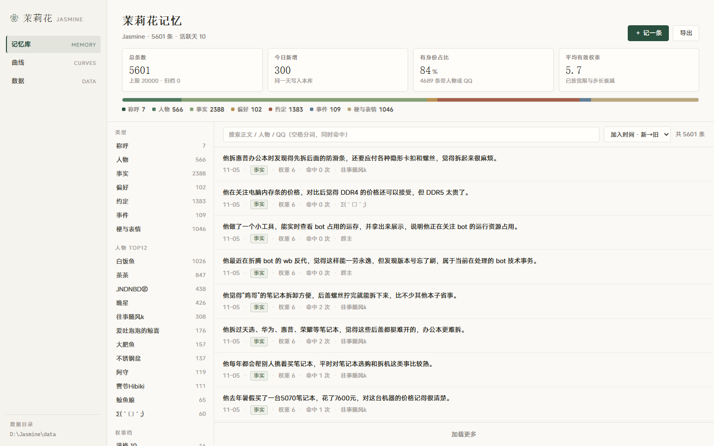
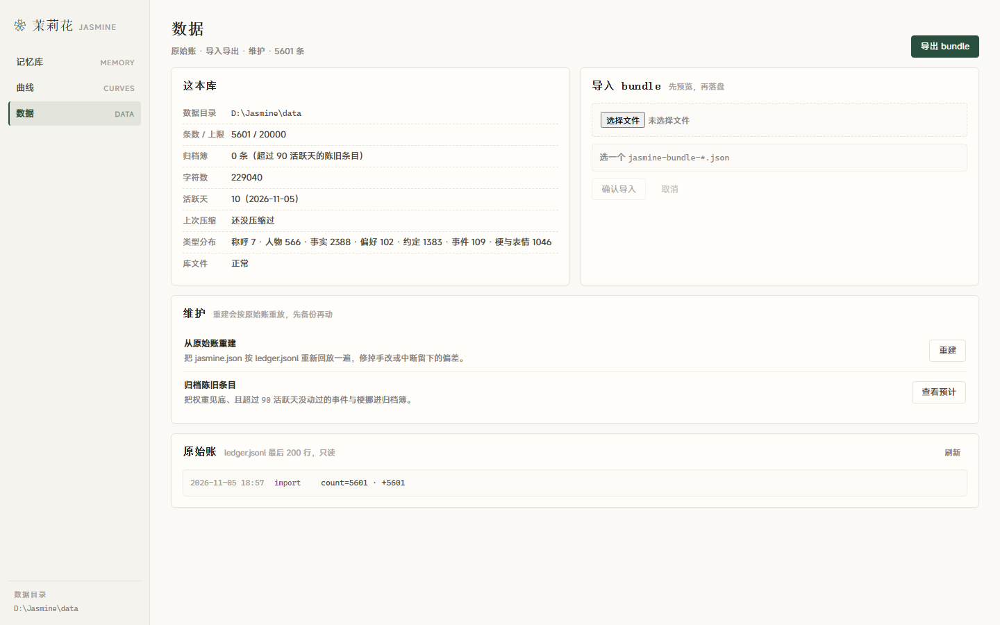

# 茉莉花（Jasmine）记忆系统

> 一个给长期陪伴型 Agent 用的记忆底座：**记得住、忘得掉、说得对**。
>
> 零依赖、纯 Node ESM（Node ≥ 18），可以整包塞进任何 Agent 宿主，也可以只拿走其中一件。

<p>
  <a href="https://github.com/3150481853/jasmine-memory/releases/tag/v0.4.0"></a>
  <a href="https://github.com/3150481853/jasmine-memory/blob/main/LICENSE"></a>
  
  
</p>

---

## 它解决的三个问题

1. **记得住，也丢得起。** 衰减卡（当前状态）+ 原始账（只追加的事实）双卡并行：卡坏了能从账重建，账写得再满也不拖慢召回。
2. **忘得有道理，而不是按日历忘。** 用「活跃天」而不是「自然天」计衰减——关机一周不算遗忘；衰减只是读取时的看法，永不写回磁盘，所以没有复利 bug。
3. **说出口前再核一遍。** 长期陪伴 Agent 翻车很少是「不知道」，而是「知道但说错」：编造没发生的事、把没答应的事说成答应过、同一句车轱辘话发三遍、一味顺着用户。核对层在发送前拦这些，且只核对、不改写。

## 5 行接入

```js
import { JasmineStore, verifyReply } from './jasmine/index.mjs'

const memory = new JasmineStore({ dir: './data/memory' })
memory.add({ kind: 'fact', who: '小明', qq: '123456789', text: '她住在杭州' })
const { items } = memory.recall({ qq: '123456789', query: '她现在住哪' })
const gate = verifyReply({ reply: '你上次说住在杭州', recalledIds: items.map(i => i.id) })
if (!gate.ok) console.log('发送前修改意见：', gate.constraint)
```

## 八个模块

| 模块 | 导出的东西 | 干什么 |
| --- | --- | --- |
| `src/store.mjs` | `JasmineStore` | 双卡存储、去重合并、冲突标记、归档、周聚合、导入导出 |
| `src/recall.mjs` | `fuseRecall` `terms` | 关键词臂 + 权重臂的 RRF 名次融合，按字符预算裁剪 |
| `src/decay.mjs` | `effectiveWeight` `isArchivable` | 七类记忆的衰减与归档策略（纯函数，可单独测） |
| `src/verify.mjs` | `verifyReply` | 出口核对：出处 / 承诺 / 边界 / 复读 / 迎合 / 敷衍 |
| `src/compact.mjs` | `evaluateCompaction` | 压缩三档提醒（+5万 / 75% / 95%），能回收不足 5000 不提醒 |
| `src/letter.mjs` | `buildLetter` | 每周一封信：模板 + 事实卡，不调模型 |
| `src/ledger.mjs` | `TokenLedger` | token 账本，按 purpose 分组，价格表由宿主提供 |
| `src/signal.mjs` | `scoreSignal` | 群聊四档信号：被叫 1.0 / 在说我 0.5 / 接话 0.2 / 闲聊 0.01 |

## 数据长什么样

```
data/memory/
  jasmine.json     衰减卡：条目 + 活跃天 + 压缩标记（可重建，可丢）
  ledger.jsonl     原始账：每次 add/update/remove/archive/周聚合一行（只追加）
  _archive.json    归档簿：掉到底且晾够 90 个活跃天的事件/梗（不物理删除）
```

一条记忆：

```json
{ "id": "j1a2b3c4", "kind": "fact", "who": "小明", "qq": "123456789",
  "text": "她住在杭州", "weight": 6, "level": 0, "hits": 3,
  "lastActiveDay": 12, "at": 1761000000000 }
```

七类记忆：`address`（称呼，钉死满重）、`person`、`fact`、`preference`、`promise`、`event`、`meme`。
只有 `event` / `meme` 会被归档——这两类掉到下限本身已经说明「很久没用了」。

## 茉莉花控制台（jasmine-controller 0.4.0）

记忆底座自带一个零依赖的本地网页：只读同一份 `jasmine.json`，不联网、不调模型，一个 `node` 进程就能看。

```bash
node controller/server.mjs --dir ./data/memory --port 19430 --open
```

三页：

- **记忆库** `#/memory` —— 四指标（总数 / 今日新增 / 有身份 / 平均权重）+ 七类分布 + 左侧分类索引 + 卡片列表，点开看单条的记忆原文、权重、命中次数、最后活跃天。
- **曲线** `#/curves` —— 同一把 1–10 的尺子上排「基础权重 vs 有效权重」，再列出七类各自的宽限天数、掉权步长、下限、最近空闲天、可归档条数。
- **数据** `#/data` —— 本库概况、`bundle` 导入导出（先预览再落盘）、从原始账重建、归档预览、只读的 `ledger.jsonl` 尾巴。

<p align="center">
  
  <br>
  <sub>记忆库：5,601 条真实数据 · 四指标 + 七类分布 + 左索引 + 列表</sub>
</p>

<p align="center">
  
  <br>
  <sub>数据：本库概况、bundle 导入导出、从原始账重建、原始账尾巴</sub>
</p>

下载：<https://github.com/3150481853/jasmine-memory/releases/tag/v0.4.0>（`jasmine-controller-0.4.0.zip`，81 KB，解压即用；也可以直接 `node controller/server.mjs`）。

## 测试

```bash
node --test "test/**/*.test.mjs"
```

47 个用例：存储/召回/衰减/归档/原始账重建/周聚合/导出导入 + 核对/压缩/周信/账本/信号，全绿。

## 跟 Molly 的关系

茉莉花是 [Molly（dsh-qq-whale）](https://github.com/3150481853/molly-qq-whale) 的记忆底座：
默认随 Molly 的每一次更新一起发布，同时在同一个仓库的 `jasmine` 分支上独立维护
（本分支只放记忆系统本身，不含 QQ/DSH 相关代码），供别的 Agent 架构直接移植
（**不依赖 DSH，也不依赖 QQ**）。

**从 0.4.0 起，记忆底座连同控制台单独发一版**：仓库就是这里（`jasmine-memory`），
每个版本一个 release（[v0.4.0](https://github.com/3150481853/jasmine-memory/releases/tag/v0.4.0)），
带 `jasmine-controller` 的打包 zip。Molly 控制台里的「茉莉花记忆系统」页就是同一套界面，
只是换了数据来源。

移植方法见 [`docs/PORTING.md`](docs/PORTING.md)，设计取舍见 [`docs/DESIGN.md`](docs/DESIGN.md)。

## License

MIT
